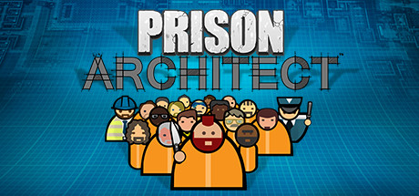

**Prison Architect is the detailed prison management simulator where you design, build, and manage a correctional facility while managing prisoner needs, gang activity, suppression, and the ethical dilemmas of incarceration.**

---

## 📖 About

Prison Architect is the detailed prison management simulator where you design, build, and manage a correctional facility while managing prisoner needs, gang activity, suppression, and the ethical dilemmas of incarceration.

## ⚠️ Problems Without Trainer

| Problem | Status |
|---------|--------|
| **Gang Activity** — Unmanaged gang warfare escalates into prison-wide riots requiring military response | ✅ Solved |
| **Contraband Smuggling** — Prisoners find creative ways to introduce contraband without thorough searches | ✅ Solved |
| **Population Balance** — Managing protective custody, death row, and general population simultaneously | ✅ Solved |
| **Escape Prevention** — Perimeter planning must account for tunneling, fence cutting, and staff hostage-taking | ✅ Solved |

## ✅ Solution

The **Prison Architect Trainer** solves all these issues by giving you complete control over the game.

## 🎯 Full Feature List

- Unlimited Resources
- God Mode / Invincibility
- Instant Skill Cooldown
- One-Hit Kill
- Freeze Game Timer
- Unlock All Items & Achievements
- Custom Speed Multiplier
- Save State Anywhere

## 🚀 Quick Start

1. **Disable Windows Defender** temporarily (trainer may trigger false positive)
2. Download the trainer from the button above
3. Launch Prison Architect
4. Run the trainer as Administrator
5. Activate desired cheats with hotkeys

## 💎 Free vs Paid

| Feature | Free | Pro |
|---------|------|-----|
| Basic God Mode | ✅ | ✅ |
| Unlimited Resources | ✅ | ✅ |
| All Advanced Cheats | ❌ | ✅ |
| Auto-Updates | ❌ | ✅ |
| Priority Support | ❌ | ✅ |

## 💻 Requirements

- Windows 10/11 (64-bit)
- Prison Architect (any version)
- .NET Framework 4.8+
- DirectX 11+

## 🍎 macOS

macOS users can use our alternative tool:

## ⚖️ Legal

This trainer is for educational and single-player use only. Use responsibly.

---

